  

  

  
  
  

## Olá, eu sou o Raphael

Sou estudante de **Análise e Desenvolvimento de Sistemas na UNICID** e tenho formação técnica em **Informática pela ETEC**. Gosto de transformar problemas em soluções claras — escrevendo código, organizando dados e aprendendo como cada parte de um sistema se conecta.

Minha experiência profissional atual é como **Operador de Teleatendimento Júnior na Konecta**. Atendo clientes do Consórcio Honda e do Banco Honda, incluindo dúvidas sobre consórcios e suporte a financiamentos de veículos. Essa vivência também fortalece minha comunicação, escuta e cuidado ao lidar com informações financeiras.

Neste GitHub, registro minha evolução por meio de projetos acadêmicos e exercícios práticos. Tenho explorado principalmente Python, lógica de programação, análise de dados e desenvolvimento de software.

## Tecnologias que estudo e aplico

  
  
  
  
  
  
  
  
  

## Projetos em destaque

| Projeto | O que você encontra |
|---|---|
| [Orion Analysis — dashboard de vendas](https://github.com/Raphael186/orion-analysis-dashboard) | Projeto acadêmico de análise de dados com Power BI. O repositório documenta o fluxo de tratamento e traz uma planilha **inteiramente sintética** para demonstração. |
| [Sistema de auditoria de dados](https://github.com/Raphael186/portfolio-raphael-luiz-lima-de-araujo/tree/main/sistema-de-auditoria-de-dados) | Exercício de lógica para verificar consistência de dados financeiros e identificar anomalias. |
| [Traduzindo lógica para Python](https://github.com/Raphael186/portfolio-raphael-luiz-lima-de-araujo/tree/main/traduzindo-logica-para-python) | Implementação em Python de funções descritas em pseudocódigo, praticando tipos, laços e controle de fluxo. |
| [Sistema de caixa e troco inteligente](https://github.com/Raphael186/portfolio-raphael-luiz-lima-de-araujo/tree/main/sistema-de-caixa-e-troco-inteligente) | Projeto de lógica para conferir pagamentos e calcular o troco com uma combinação eficiente de cédulas. |
| [Engenharia de soluções lógicas](https://github.com/Raphael186/portfolio-raphael-luiz-lima-de-araujo/tree/main/engenharia-de-solucoes-logicas) | Proposta e fluxograma de uma solução lógica para controle de semáforos e tráfego. |

## Formação

- **Análise e Desenvolvimento de Sistemas — UNICID** · estudante.
- **Técnico em Informática — ETEC** · 2022–2023.

## Um pouco da minha jornada

Estou construindo minha base projeto a projeto: entender o problema, dividir a lógica em etapas, testar uma solução e explicar o que fiz. Tenho interesse em programação, dados e tecnologia aplicada ao cotidiano. Se algum projeto despertar sua curiosidade, fique à vontade para abrir uma issue ou conversar pelo LinkedIn.

  
  

Em constante aprendizado — um commit e uma ideia de cada vez.

